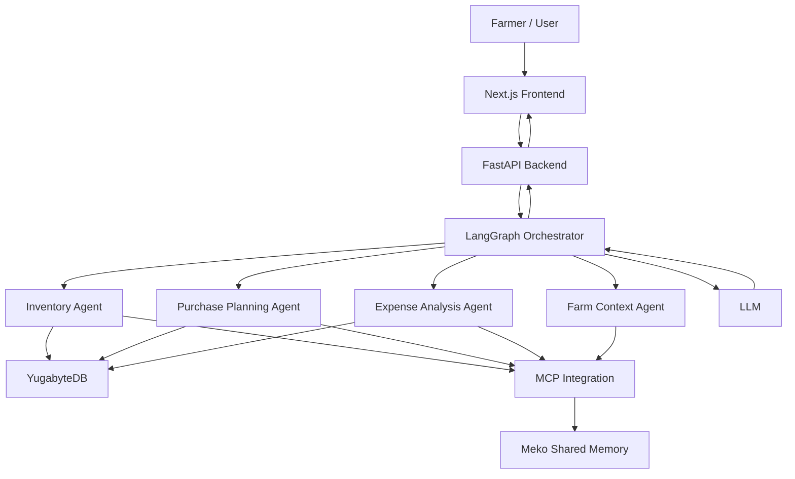
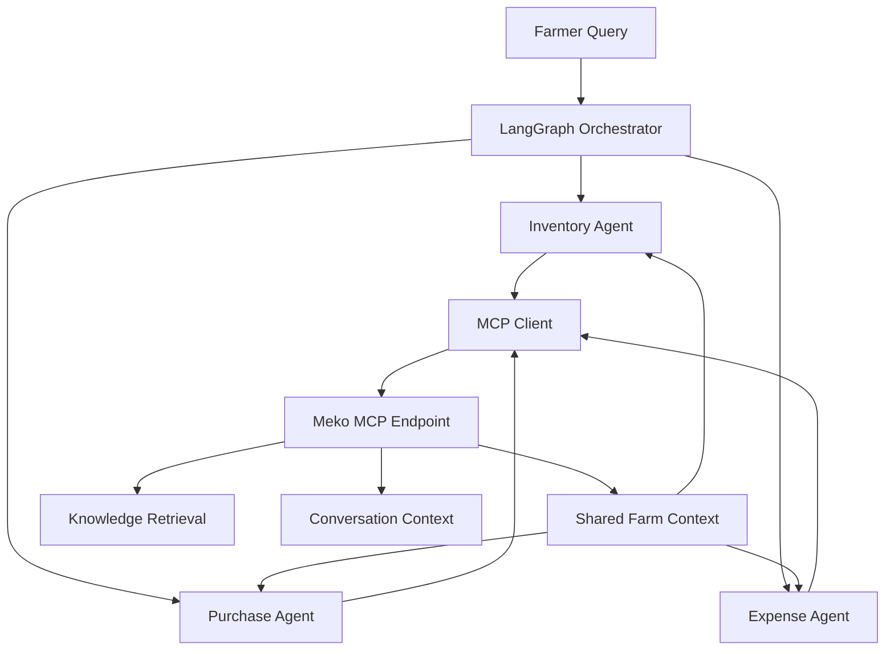
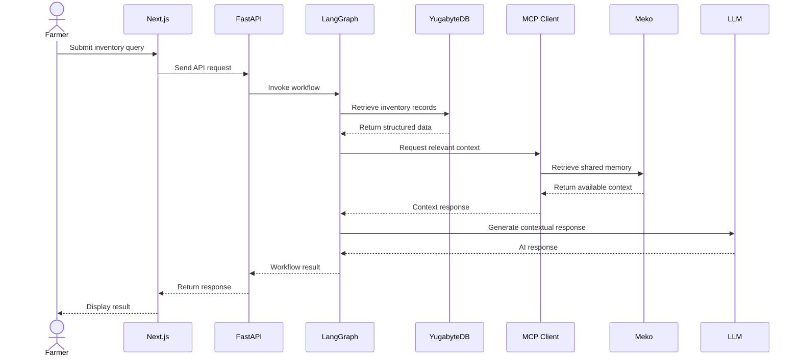
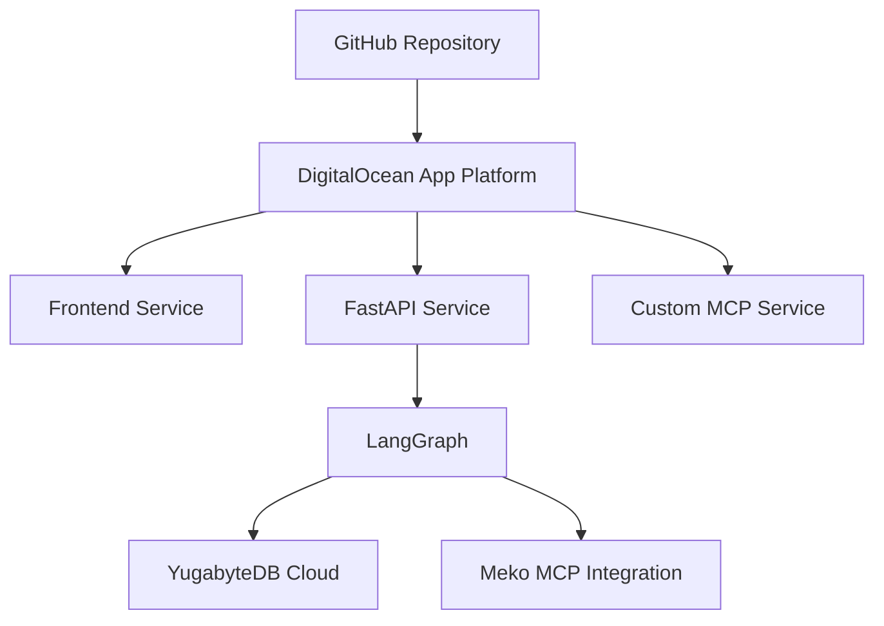

# 🌾 Farm Inventory Management System
### Intelligent Inventory. Connected Agents. Smarter Farming..

<p align="center">

**An AI-powered agricultural inventory management platform combining distributed SQL, multi-agent orchestration, and shared AI memory to simplify farm resource management.**

</p>

<p align="center">


</p>

---

## 📌 Overview

Agricultural inventory management involves much more than tracking quantities of seeds and fertilizers. Farmers must coordinate purchases, monitor consumption, manage suppliers, track harvested produce, control expenses, and ensure that essential resources are available at the right time.

Traditional inventory management approaches often rely on manual records, disconnected spreadsheets, and repetitive data entry. These approaches make it difficult to maintain accurate records, understand historical consumption, and make informed purchasing decisions.

**Our Farm Inventory Management System aims to transform this process through intelligent automation and AI-powered decision support.**

The platform combines:

- **YugabyteDB** for structured, reliable inventory and transactional data.
- **Meko** for shared AI-agent memory and contextual knowledge through MCP.
- **LangGraph** for orchestrating specialized AI agents.
- **FastAPI** for backend services and API communication.
- **Next.js** for an intuitive farmer-facing interface.

Rather than treating inventory as a collection of isolated records, the system is designed to connect farm information, historical activity, and AI-assisted reasoning into a unified management experience.

## 🎯 Problem Statement

Farmers and agricultural businesses manage several interconnected resources:

- Seeds and planting materials.
- Fertilizers and soil nutrients.
- Pesticides and crop protection products.
- Agricultural equipment and tools.
- Harvested produce and storage.
- Suppliers, purchases, and expenses.

When these records are maintained separately, farmers may face stock discrepancies, unexpected shortages, unnecessary purchases, poor expense visibility, and difficulty tracking resource consumption.

The challenge becomes more significant when managing multiple farms, crops, warehouses, and agricultural seasons.

A useful inventory system must therefore do more than store quantities. It must understand the relationship between farm activities, available resources, historical records, and purchasing decisions.

## 💡 Our Solution

We are building an intelligent farm inventory platform that combines conventional inventory management with AI-powered assistance.

The system is designed to help farmers:

1. Maintain organized records of agricultural resources.
2. Monitor stock availability and inventory movements.
3. Record purchases and resource consumption.
4. Manage supplier and purchase information.
5. Review inventory history and expenses.
6. Identify potential shortages and inventory requirements.
7. Interact with AI agents using natural language.
8. Retrieve relevant farm context from previous interactions.

The objective is to make agricultural resource management more transparent, organized, and intelligent.

---

## 🏗️ System Architecture

The platform follows a modular architecture that separates the user interface, backend services, AI orchestration, persistent inventory storage, and shared agent memory.



### Architecture Components

| Component | Responsibility |
|---|---|
| Next.js | Farmer-facing user interface |
| FastAPI | Backend APIs and application logic |
| LangGraph | AI workflow orchestration |
| Specialized agents | Inventory, purchasing, expenses, and farm context |
| MCP | Standardized access to external tools and shared context |
| Meko | Shared AI memory and knowledge layer |
| YugabyteDB | Structured farm inventory and transactional database |
| LLM | Natural-language reasoning and response generation |

---

## 🧠 Meko: Shared Memory for AI Agents

One of the central architectural elements of this project is **Meko**.

Traditional multi-agent systems can struggle when each agent operates with isolated context. An inventory agent may know that fertilizer stock is low, while a purchase-planning agent may not have access to the relevant information or previous farmer preferences.

We use Meko as a shared context and memory layer that allows our AI agents to work with relevant information across interactions.

### Why Meko?

Meko provides an MCP-accessible integration for agents to work with shared information instead of requiring every agent to maintain an entirely separate context-management system.

Our intended integration uses Meko for:

**1. Persistent Farm Context**

Relevant farm information and farmer preferences can be retained and retrieved across interactions, reducing repetitive questions and improving contextual assistance.

**2. Shared Agent Memory**

Multiple specialized agents can access relevant shared context.

For example, information identified by an inventory agent can be useful to a purchase-planning agent.

**3. Knowledge Retrieval**

Relevant agricultural documents and previously stored knowledge can be made accessible to AI workflows through the configured Meko integration.

**4. Conversation Context**

Previous interactions can provide useful context for subsequent queries, allowing the assistant to maintain continuity.

**5. Decision Context and Traceability**

Where supported by the configured integration, agent activity and decision context can be inspected to help understand how information was used.

### Meko Integration Architecture



### Example: Shared Memory Across Agents

Consider a farmer who manages five acres of wheat.

**First interaction**

Farmer:

> I manage five acres of wheat and usually purchase fertilizer from my preferred supplier.

The system can retain relevant farm context through the configured Meko integration.

**Second interaction**

Farmer:

> What should I consider before purchasing fertilizer again?

The AI workflow can retrieve relevant available context, such as the farmer's previous information and preferences, rather than starting the conversation without context.

**Agent collaboration**

The inventory agent can identify available stock from YugabyteDB, while the purchase-planning agent uses the relevant context to assist with the next purchasing decision.

This demonstrates the intended relationship between persistent operational data and shared AI context.

> Meko is the shared context layer. It does not replace YugabyteDB as the authoritative inventory database.

---

## 🗄️ YugabyteDB: The Foundation of Inventory Data

YugabyteDB provides the structured database layer for the platform.

Inventory management requires reliable records because purchases, consumption, transfers, and stock adjustments must be reflected accurately.

We use YugabyteDB as the PostgreSQL-compatible distributed SQL database for operational records.

### Data Management Responsibilities

| Data category | Example information |
|---|---|
| Farm records | Farm identification and details |
| Inventory | Product names, quantities, units and categories |
| Stock movements | Stock received, consumed and adjusted |
| Purchases | Purchase records, quantities and costs |
| Suppliers | Supplier information and relationships |
| Harvest records | Harvest and storage information |
| Expenses | Resource-related expenditure |
| Transaction history | Historical inventory activity |

### Why YugabyteDB?

- PostgreSQL compatibility.
- Distributed SQL architecture.
- Transactional data management.
- A scalable foundation for growing inventory workloads.
- Familiar SQL interfaces and ecosystem.

YugabyteDB is responsible for the structured operational data, while Meko supports contextual AI workflows.

---

## 🤖 Multi-Agent AI Architecture

The platform is designed around specialized agents coordinated through LangGraph.

Instead of depending on one general-purpose assistant for every operation, different agents can handle distinct responsibilities.

### 1. Inventory Management Agent

Responsible for inventory-related operations.

Potential responsibilities:

- Retrieve inventory information.
- Check stock availability.
- Record stock movements.
- Identify low-stock conditions.
- Retrieve inventory history.

### 2. Purchase Planning Agent

Responsible for supporting purchasing decisions.

Potential responsibilities:

- Review available inventory.
- Identify purchase requirements.
- Examine historical purchasing information.
- Compare relevant supplier information.
- Assist with purchase planning.

### 3. Expense Analysis Agent

Responsible for understanding resource-related expenses.

Potential responsibilities:

- Analyze purchase records.
- Summarize inventory expenses.
- Review historical expenditure.
- Identify major spending categories.

### 4. Farm Context Agent

Responsible for accessing relevant farm information and contextual knowledge.

Potential responsibilities:

- Retrieve relevant farmer context.
- Access shared information through Meko.
- Support contextual responses.
- Provide relevant information to other agents.

*Agent responsibilities describe the intended system architecture. Only agents and tools implemented in the repository should be presented as operational features.*

---

## 🔄 Complete System Workflow

The following workflow explains how the major components interact.

### Step 1 — Farmer Interaction

The farmer interacts with the Next.js dashboard and submits an inventory request or asks a question.

### Step 2 — Backend Processing

FastAPI receives the request, validates the input, and invokes the appropriate application workflow.

### Step 3 — AI Orchestration

LangGraph coordinates the agent workflow and determines which specialized agent or tools are relevant.

### Step 4 — Operational Data Retrieval

The relevant agent accesses YugabyteDB through the application's database layer to retrieve structured inventory information.

### Step 5 — Shared Context Retrieval

When required, the agent accesses Meko through MCP to retrieve relevant shared memory and contextual knowledge.

### Step 6 — AI Reasoning

The LLM uses the retrieved information and available context to formulate an appropriate response.

### Step 7 — Response Generation

The backend returns the result to the frontend, where the farmer can view the information.



---

## 🔌 Model Context Protocol (MCP)

MCP provides a standardized interface for connecting AI applications with external tools and context sources.

In this project, MCP is used to connect our AI workflow with the Meko integration.

It allows our application to access the configured Meko capabilities through an MCP client instead of embedding all memory-management logic directly inside every agent.

### MCP's Role

- Connect the AI application to Meko.
- Provide standardized access to supported tools.
- Make shared context accessible to agent workflows.
- Separate agent reasoning from external integration details.

### Integration Distinction

There are two different concepts in the architecture:

1. **Meko's hosted MCP endpoint:** Provides access to the Meko integration.
2. **Our custom Farm Inventory MCP server:** Exposes our own farm-related tools to compatible MCP clients, if implemented and deployed.

These are separate MCP integrations and should not be confused.

---

## 📄 Document Intelligence and RAG

The platform's document-intelligence architecture can support agricultural document workflows.

Examples of relevant documents include:

- Fertilizer invoices.
- Soil reports.
- Agricultural product information.
- Farm-related reports.
- Agricultural reference documents.

A typical RAG workflow consists of:

1. Document upload.
2. Text extraction.
3. Text cleaning and chunking.
4. Embedding generation.
5. Knowledge indexing.
6. Relevant context retrieval.
7. LLM-based response generation.

The purpose is to make relevant document information available to AI workflows.

Only document-processing and retrieval capabilities connected in the actual application should be treated as live features.

---

## 🧰 Technology Stack

| Layer | Technology |
|---|---|
| Frontend | Next.js, React, TypeScript |
| Styling | Tailwind CSS |
| Backend | Python, FastAPI |
| AI orchestration | LangChain, LangGraph |
| Multi-agent architecture | Specialized AI agents |
| Model integration | Configured LLM provider |
| Agent communication | Model Context Protocol |
| Shared AI memory | Meko |
| Operational database | YugabyteDB |
| Document intelligence | RAG, embeddings, retrieval |
| Containerization | Docker |
| Source control | Git, GitHub |
| Hosting target | DigitalOcean App Platform |

---

## ☁️ Deployment Architecture

The intended deployment architecture uses DigitalOcean App Platform as the primary application hosting platform.

| Component | Deployment target |
|---|---|
| Frontend | DigitalOcean App Platform |
| FastAPI backend | DigitalOcean App Platform |
| Custom MCP server | DigitalOcean App Platform |
| LangGraph workflows | Backend service or separate worker, as required |
| YugabyteDB | YugabyteDB Cloud |
| Meko | Meko hosted integration |
| Source code | GitHub |

### Deployment Workflow



Deployment status and public service URLs should be added after successful production deployment.

---

## 🔐 Security and Reliability

The system should follow these security practices:

- Keep API keys and database credentials outside source code.
- Store production secrets using the hosting provider's secret-management facilities.
- Use HTTPS for remote application and MCP connections.
- Protect MCP endpoints with authentication.
- Use TLS for database connectivity.
- Validate incoming API requests.
- Restrict CORS to authorized frontend origins.
- Apply appropriate authorization to farmer and farm records.
- Avoid exposing sensitive information in application logs.

---

## 🚀 Getting Started

### Prerequisites

Install the following tools:

- Python 3.11 or the version required by the backend.
- Node.js version compatible with the frontend.
- Git.
- Docker (recommended).
- Access to YugabyteDB Cloud.
- Meko credentials and supported MCP integration.
- Credentials for the configured LLM provider.

### 1. Clone the Repository

```bash
git clone YOUR_GITHUB_REPOSITORY_URL
cd YOUR_PROJECT_DIRECTORY
```

### 2. Configure the Backend

Navigate to the backend directory identified in the repository.

Create a virtual environment:

```bash
python -m venv venv
```

Activate it on Windows:

```bash
venv\Scripts\activate
```

Install dependencies using the repository's existing dependency file:

```bash
pip install -r requirements.txt
```

Configure the backend environment using the provided `.env.example`.

### 3. Configure the Frontend

Navigate to the frontend directory.

Install dependencies using the existing package manager:

```bash
npm install
```

Configure the backend API URL in the appropriate frontend environment file.

### 4. Configure External Integrations

Set the actual configuration values required by the implementation:


These are illustrative configuration names. Use the exact environment variable names expected by your source code.

Never commit real credentials to GitHub.

### 5. Start the Backend

Use the actual FastAPI application entry point.

Example:

```bash
uvicorn main:app --reload --host 0.0.0.0 --port 8000
```

### 6. Start the Frontend

```bash
npm run dev
```

Open the local frontend URL displayed by the development server.

---

## 📁 Project Structure

The exact repository structure may differ. A conceptual organization is:

```text
farm-inventory/
│
├── frontend/
│   ├── app/
│   ├── components/
│   ├── hooks/
│   └── package.json
│
├── backend/
│   ├── api/
│   ├── agents/
│   ├── graph/
│   ├── mcp/
│   ├── database/
│   ├── services/
│   ├── schemas/
│   ├── utils/
│   └── main.py
│
├── docs/
│   ├── architecture.md
│   └── workflow.md
│
├── docker-compose.yml
├── .gitignore
├── .env.example
└── README.md
```

---

## 🧪 Testing and Validation

Before treating the system as production-ready, validate:

- Frontend build and routing.
- Backend API availability.
- Database connection and inventory operations.
- Stock-in and stock-out transactional behavior.
- Supplier and purchase record handling.
- MCP authentication and connectivity.
- Meko memory write and retrieval.
- Shared context access by intended agents.
- LLM response generation.
- Authorization and data isolation.

The presence of a configured integration does not by itself prove that the end-to-end workflow works. Validate each connection with actual requests.

---

## 🛣️ Future Scope

Potential extensions include:

- Advanced inventory demand forecasting.
- Crop-cycle-aware resource planning.
- Intelligent purchase recommendations.
- Multi-farm inventory analytics.
- Supplier comparison and procurement optimization.
- Advanced document intelligence.
- Offline-first inventory management.
- Historical consumption analysis.
- More specialized agricultural AI agents.

---

## 🌱 Vision

We believe that intelligent farming requires more than collecting agricultural data. It requires connecting information, understanding context, and turning that information into useful decisions.

By combining distributed SQL infrastructure, shared AI memory, MCP integrations, and multi-agent reasoning, this project aims to create a more intelligent foundation for agricultural resource management.

**Every resource matters. Every decision counts. Every farm deserves better intelligence.**

---


### Acknowledgements

- [YugabyteDB](https://www.yugabyte.com/) — Distributed SQL database.
- [Meko](https://mekodata.ai/) — Shared AI memory and MCP integration.
- [LangGraph](https://www.langchain.com/langgraph) — Agent orchestration.
- [FastAPI](https://fastapi.tiangolo.com/) — Backend framework.
- [Model Context Protocol](https://modelcontextprotocol.io/) — Standardized AI tool integration.
- [DigitalOcean](https://www.digitalocean.com/) — Application hosting.

---

<p align="center">

**Built to make farm resource management smarter, more connected, and more reliable. 🌾**

</p>
